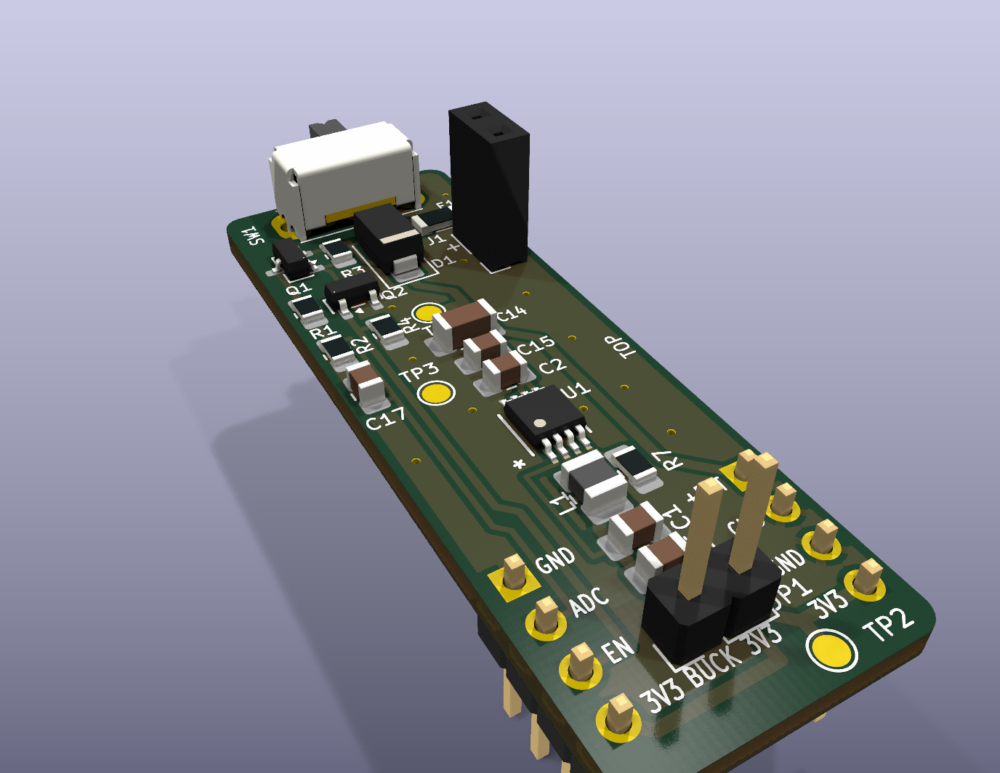
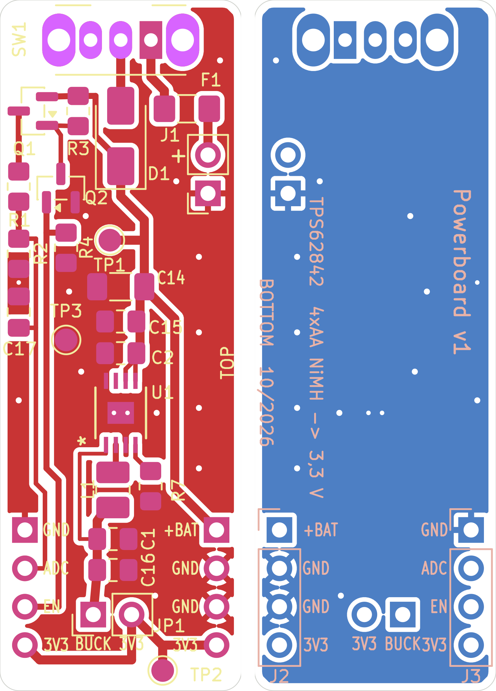

# Powerboard v1

A small 3.3 V supply module for battery-powered microcontroller projects: 4x AA NiMH in,
regulated 3.3 V out, with an ultra-low quiescent current buck converter (TI TPS62842, 60 nA Iq),
a switchable battery-voltage divider for an MCU ADC, a jumper for current measurement and
test points. Breadboard format with two 1x04 pin headers 12.7 mm apart, like
[olmBoard](https://github.com/azerimaker/olmBoard) (which uses the TPS62840 from the same family).



| | |
|---|---|
| Input | 4x AA NiMH, 4.8 ... 5.6 V (converter accepts 1.8 ... 6.5 V) |
| Output | 3.3 V (set by R7 = 52.3 kΩ 1 %) |
| Output current | converter 750 mA max, **but SW1 is rated 100 mA** → about 120 mA at 3.3 V as built (see [SW1](#sw1-onoff-switch)) |
| Quiescent current | 60 nA (TPS62842) + MOSFET leakage; the battery divider draws nothing while it is off |
| Protection | 500 mA polyfuse F1, reverse-polarity Schottky diode D1 (SS14) |
| Board | 16.0 x 45.72 mm, 2 layers, 1.6 mm, KiCad 10 |

## Board overview



Top view, switch at the top edge:

```
            SW1 (actuator sticks out over the edge)
   Q1 R3              D1        F1
   R1 Q2                        J1  (battery: + upper pin, - square pad)
   R2 R4   TP1 (+BATT)
   C17     C14 C15 C2
   TP3 (GND)    U1                  TOP
                L1 R7
  J3 ●  GND     C1 C16       +BAT  ● J2
     ●  ADC                   GND  ●
     ●  EN      JP1 [BUCK|3V3] GND  ●
     ●  3V3                   3V3  ●
                       TP2 (+3V3)
```

## Connecting it

### Battery (J1)

2-pin socket, 2.54 mm pitch, for the plug of a 4x AA holder.

| J1 pin | Silkscreen | Connect |
|--------|------------|---------|
| 1 | square pad | battery − (black) |
| 2 | `+` | battery + (red) |

D1 blocks a reversed battery, so a wrong plug does no harm (the board just stays off).

### Pin headers J2 / J3

Mounted from the bottom: plastic under the board, long pins down into the breadboard. Pin 1 is
on the switch side. The labels are printed next to the pins on both sides of the board.

| Pin | J3 (left, `SIG`) | J2 (right, `PWR`) |
|-----|------------------|-------------------|
| 1 | GND | +BATT (battery after switch and diode) |
| 2 | ADC (battery voltage / 2, only while EN is high) | GND |
| 3 | EN (enable battery measurement, 3.3 V logic input) | GND |
| 4 | +3V3 | +3V3 |

+3V3 on J2.4 and J3.4 is the same rail, after the current jumper JP1. All GND pins are the same.

### SW1 on/off switch

SW1 is a C&K **OS102011MA1Q**, a right-angle (side-actuated) SPDT slide switch, through-hole.
The footprint looks big because of its two large oval pads: they are the soldered legs of the metal
frame that hold the switch mechanically and carry no signal. The three small pads in the middle
are the contacts; only pins 1 and 2 are used (pin 1 = right, pin 2 = middle, pin 3 unused).

- ON = pins 1 and 2 connected. Check which slider position that is with a continuity tester
  before first use (probe the right and the middle small pad).
- The switch is rated 100 mA. That is enough for a microcontroller with sensors, but it limits
  the module to about 120 mA at 3.3 V. For more current, replace SW1 by a higher-rated switch
  or a wire bridge between pins 1 and 2.

### Microcontroller, e.g. STM32WB Nucleo

| Powerboard | Nucleo |
|------------|--------|
| J3.1 GND | GND |
| J3.2 ADC | any ADC input pin (Arduino header A0 ... A5) |
| J3.3 EN | any free GPIO, push-pull output |
| J3.4 +3V3 | 3V3, **only** if the Nucleo is not powered over USB at the same time |

If the Nucleo runs from USB, connect only GND, ADC and EN; never tie two 3.3 V supplies together.

## Measuring the battery voltage (EN / ADC)

R1/R2 (1 MΩ / 1 MΩ) divide the battery voltage by two. Q1 (AO3401A, P-channel) switches the
divider on and off at the battery side, Q2 (AO3400A, N-channel) lets a 3.3 V GPIO drive Q1.

| EN | State | Current |
|----|-------|---------|
| high (3.3 V) | Q2 on → Q1 on → divider on, ADC = VBAT / 2 | ≈ 12 µA (2.8 µA divider, 5.6 µA R3, 3.3 µA R4) |
| low or open | R4 keeps Q2 off, R3 keeps Q1 off → divider off, ADC = 0 V | MOSFET leakage only (nA) |

The divider is off while the MCU is in reset or the pin is floating, so it never drains the battery
by accident. While it is off the ADC pin sees 0 V, never more than the MCU supply.

Measurement sequence:

1. Set EN high.
2. Wait at least **0.6 s**: C17 (150 nF) charges through R1 ∥ R2 = 500 kΩ, τ = 75 ms; 8 τ settle to 12-bit accuracy.
3. Read the ADC: V_ADC.
4. Set EN low (or switch the pin to input / analog).
5. VBAT = 2 × V_ADC. This is the voltage after D1; the battery itself is about 0.2 ... 0.4 V higher (SS14 forward drop at the actual load).

Example (STM32 HAL, pin names are placeholders):

```c
HAL_GPIO_WritePin(MEAS_EN_GPIO_Port, MEAS_EN_Pin, GPIO_PIN_SET);
HAL_Delay(600);                                   /* C17 settling */
HAL_ADC_Start(&hadc1);
HAL_ADC_PollForConversion(&hadc1, 10);
uint32_t raw = HAL_ADC_GetValue(&hadc1);
HAL_GPIO_WritePin(MEAS_EN_GPIO_Port, MEAS_EN_Pin, GPIO_PIN_RESET);
float vbat = 2.0f * raw * 3.3f / 4095.0f;         /* 12 bit, VREF = 3.3 V */
```

## Current measurement (JP1)

JP1 is a 2-pin header with a jumper cap between the converter output and the +3V3 rail.
It is **not** a power connector and has no GND pin.

| JP1 pin | Silkscreen | Net |
|---------|------------|-----|
| 1 (square pad) | `BUCK` | converter output (U1 / L1 / C1) |
| 2 | `3V3` | +3V3 rail (J2.4, J3.4, TP2) |

- Normal operation: jumper cap **on**.
- Measuring: pull the jumper cap and connect the multimeter in current mode:
  red probe (mA / µA input) on `BUCK`, black probe (COM) on `3V3`.
  The meter then shows everything drawn from +3V3 through the headers.
- Start in the mA range: a µA range has a large shunt resistance, so the start-up current of an
  MCU can drop the voltage too far and reset it. Switch to µA once the MCU sleeps.
- Not included in this reading: the converter's own 60 nA, the battery divider (only while EN is
  high) and the MOSFET drive. To measure the total battery current, put the meter in the battery lead.

## Test points

SMD pads, 1.5 mm, for probe tips or small clips.

| TP | Net | Where |
|----|-----|-------|
| TP1 | +BATT (battery after SW1 and D1) | below D1, next to Q2 |
| TP2 | +3V3 (after JP1) | bottom edge, right of JP1 |
| TP3 | GND | left side, next to C15 / C2 |

Battery voltage: TP1 against TP3. Output voltage: TP2 against TP3.

## Layout notes

- Signals on F.Cu, B.Cu is a solid GND plane, GND fill on F.Cu, stitching vias
- Converter laid out after the TPS62840 datasheet (DGR layout, fig. 63): C2 (4.7 µF) directly on
  VIN/EN and GND, MODE and pin 8 into the exposed pad with two thermal vias, VOS as a separate
  sense line to C1 away from the switching node, R7 on the VSET side away from SW
- Net classes: `Default` 0.4 mm, `Versorgung` (supply) 0.6 mm; copper-to-edge 0.5 mm
- Checks: ERC 0 errors / 0 warnings, DRC 0 violations, 0 unconnected, schematic parity OK

## Files

```
powerboard/
├── README.md
├── powerboard-docs/            renders: 3D, top, bottom, layout, schematic
└── powerboard-hw/
    ├── powerboard-lib/         project library: TPS62842DGRR symbol, DGR footprint, STEP model
    └── powerboard-v1/          KiCad 10 project
        ├── powerboard-v1.kicad_pro / .kicad_sch / .kicad_pcb / .kicad_dru
        ├── sym-lib-table, fp-lib-table   (only ${KIPRJMOD}-relative paths)
        ├── schematic/          schematic PDF
        ├── bom/                BOM (CSV, grouped by value and footprint)
        └── fabrication/        Gerbers, Excellon drill, position file, gerber zip
```

Only the KiCad standard libraries are needed besides this folder.

## Regenerating the outputs

From `powerboard-hw/powerboard-v1/`:

```bash
kicad-cli pcb export gerbers -l F.Cu,B.Cu,F.Paste,B.Paste,F.Silkscreen,B.Silkscreen,F.Mask,B.Mask,Edge.Cuts --use-drill-file-origin --subtract-soldermask -o fabrication/gerbers/ powerboard-v1.kicad_pcb
kicad-cli pcb export drill --drill-origin plot --excellon-separate-th --generate-map --map-format gerberx2 -o fabrication/gerbers/ powerboard-v1.kicad_pcb
kicad-cli pcb export pos --side both --format csv --units mm --use-drill-file-origin -o fabrication/powerboard-v1-pos.csv powerboard-v1.kicad_pcb
kicad-cli sch export bom --fields 'Reference,Value,Footprint,${QUANTITY},Datasheet,Description' --labels 'Refs,Value,Footprint,Qty,Datasheet,Description' --group-by 'Value,Footprint' -o bom/powerboard-v1-bom.csv powerboard-v1.kicad_sch
kicad-cli sch export pdf -o schematic/powerboard-v1.pdf powerboard-v1.kicad_sch
```

## Status

v1, not manufactured or tested yet.
